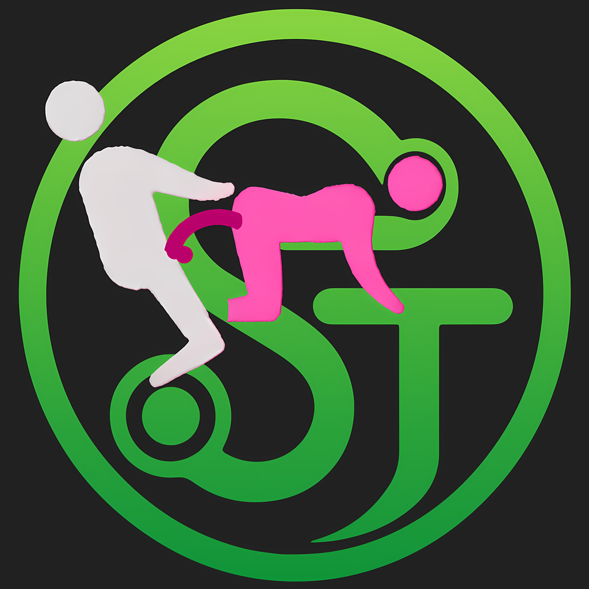

<div align="center">
  

  <h1>SteamDaddy DLLs</h1>

  <p>
    <strong>High-Performance Steam Unlock, Ticket Generation & Manifest Management Engine</strong>
  </p>

  <p>
    
    
    
    <a href="https://github.com/Contrary7/SteamDaddy-Dlls">
      
    </a>
    <a href="https://github.com/Contrary7/SteamDaddy-Backup">
      
    </a>
  </p>
</div>

---

## Overview

**SteamDaddy** is an advanced C++20 user-space dynamic instrumentation engine for the Valve Steam client. Loaded via Windows PE sideloading (`version.dll` or `dwmapi.dll`), SteamDaddy intercepts Steam client IPC protocols, packet structures, and memory interfaces to deliver transparent DLC and game unlocking, automated depot manifest resolution with failover, donor ticket generation, offline Denuvo/SteamStub authorization, third-party CDKey resolution, and cloud save redirection.

> [!TIP]
> **Better Together with SteamDaddy (Main Ecosystem):**  
> This repository contains the standalone, low-level C++ binaries (`SteamDaddy.dll`, `version.dll`, `dwmapi.dll`).  
> For the complete end-user experience—including an intuitive GUI, 1-click game unlocking, ContraryCDN API integration, auto-patching online fixes, achievement syncing, and native Millennium UI integration directly inside your Steam client—we strongly recommend using this core alongside the primary **SteamDaddy** platform maintained at:  
> 
> 👉 **[Contrary7/SteamDaddy-Backup](https://github.com/Contrary7/SteamDaddy-Backup)** — *The ultimate SteamTools alternative & manifest manager.*

---

## Features

### Core Unlocks & Manifest Management
* **Zero-Limit App & DLC Unlocking**: Register an unlimited number of games and DLCs via Lua scripts in `<Steam>/config/stplug-in/`.
* **Depot Decryption Key Injection**: Automatically resolves and supplies depot decryption keys on demand from Lua definitions.
* **Multi-Upstream Manifest Engine with Automatic Failover**:
  Queries upstream APIs in priority order with sequential failover and a 60-second cooldown per failed upstream:
  1. `20770407` (`https://20770407.xyz/manifest/{depotId}/{gid}`) — **Default**
  2. `SDM` (`https://steamapi.993499094.xyz/manifest/{depotId}/{gid}`)
  3. `manifestdex` (`https://manifest.manifestdex.com/{gid}`)
  4. `wudrm` (`http://gmrc.wudrm.com/manifest/{gid}`)
  5. `steamrun` (`https://manifest.steam.run/api/manifest/{gid}`)
  6. `opensteamtool` (`https://manifest.opensteamtool.com/{gid}`)
* **Custom Lua Manifest Endpoints**: Define `fetch_manifest_code(gid)` or `fetch_manifest_code_ex(app_id, depot_id, gid)` in `config/stplug-in/manifest.lua` using built-in `http_get` and `http_post` functions.
* **Manifest Pinning & Locking (`setManifestid`)**: Pin specific depot manifest versions to prevent unwanted game updates and preserve offline Denuvo activations.
* **Ownership-Aware Manifest Locking (`lock_owned_games`)**: When set to `false` (default), genuinely owned games receive official updates normally, while unowned games remain locked.
* **Background Auto-Sync on Update (`auto_sync_on_update`)**: Automatically updates local `.lua` configurations and manifest cache mirrors in the background as soon as Steam finishes downloading an update.
* **Automatic Depot Cache Mirroring**: Downloaded `.manifest` files are automatically mirrored directly into `<Steam>/depotcache/`.

### Third-Party Retail Keys ("Updating product key" Fix)
* **Legacy CDKey Protocol Emulation**: Intercepts `MsgClientGetLegacyGameKey` packets for external publisher launchers (Ubisoft Connect, EA, Rockstar).
* **Synthetic Fallback**: When no key is defined with `setlegacycdkey(appid, "KEY")`, SteamDaddy generates a deterministic synthetic key locally so Steam completes the client-side registration step without hanging.

### Denuvo & SteamStub Protection Compatibility
* **SteamStub Compatibility**: AppID spoofing via local ConfigStore tickets exploiting a SteamDRMP off-by-four ticket parsing vulnerability—no game process injection required.
* **Platform Credential Store Integration**: Explicit `AppTicket` and `ETicket` hex strings configured via `setAppTicket(appid, "hex")` and `setETicket(appid, "hex")` are stored in `HKCU\Software\Valve\Steam\Apps\<AppId>\AppTicket`.
* **Scheme 2 Multi-Stage Adaptive Leasing (`-dauth2` / `dauth2(appid)`)**: Dynamically extends ticket lease windows for titles with strict timeout windows.
* **Helper Launch Options**:
  * `-dauth2`: Enable Scheme 2 adaptive ticket lease extension.
  * `-d+` (alias `-lua`): Auto-generates `<AppId>.lua` and locks manifests when launched from an account that genuinely owns the game.
  * `-forcedenuvo`: Force treat the game as Denuvo-protected (or `forcedenuvo(appid)` in Lua).
  * `-nodenuvo`: Bypass Denuvo ticket handling entirely (or `nodenuvo(appid)` in Lua).
* **30-Minute Validity Window**: Denuvo tokens have a 30-minute validity window. If authorization expires (Denuvo error `88500005`), refresh tickets from a genuine owning account.

### Ticket & Credential Extraction (`extract_tickets`)
Extracts `AppTicket`, `ETicket`, DLC lists, depot keys, manifests, and auto-generates `<appid>.lua` on genuine accounts:
* **Interactive Terminal UI (TUI)**: Run `extract_tickets.exe` directly without arguments for an interactive console UI with account switching and library search.
* **Clientless Online Mode (`--online` / `-o`)**: Connects directly to Valve Connection Manager (Steam CM) servers over TCP/TLS for headless extraction with QR-code or saved credentials—no local Steam client required!
* **CLI Commands**:
  ```powershell
  # Interactive TUI mode
  extract_tickets.exe

  # Standard extraction for locally installed game
  extract_tickets.exe 1361510

  # Force ETicket extraction for uninstalled game
  extract_tickets.exe 1361510 --force-eticket

  # Headless online extraction via Steam CM servers
  extract_tickets.exe --online --appid 1361510
  ```

### Online Fix & Multiplayer
* **Spacewar Matchmaking (`-onlinefix`)**: Add `-onlinefix` to Steam launch parameters to enable AppID 480 matchmaking while preserving save isolation and real AppID reporting.
* **P2P Certificate Flip (`-p2pflip`)**: Add `-onlinefix -p2pflip` for rare multiplayer titles requiring strict 480 certificate matching in P2P handshakes.

### Family Sharing Bypass
* **Zero-Configuration Bypass**: The lender's library is never locked, and borrowed games lose their borrowed and license-locked status flags.

### Stats & Achievements
* **Achievement & Stat Tracking**: Enables statistics and achievements for unlocked unowned games.
* **Resolution Priority**:
  1. Lua Override: `setStat(appid, "steamid")`
  2. Live Upstream API: `https://stats.opensteamtool.com/{appid}` (queried automatically when `[stats] enable_api = true`)
  3. Default Preset SteamID: `76561198028121353`

### Cloud Save Redirection (CloudRedirect)
* Integrates [CloudRedirect](https://github.com/Selectively11/CloudRedirect) to redirect cloud save RPCs to external storage providers (Google Drive, OneDrive, local directories) while preserving memory isolation.

### Dynamic Binary Instrumentation & Pattern Engine
* **0ms Early Chokepoint Detours**: `Hooks_Diversion` traps `KERNELBASE!LoadLibraryExW` at process startup to ensure zero race conditions before Steam components load.
* **Multi-Pattern IDA Signature Scanner**: Scans runtime binary code using IDA byte signatures (`sig`) with multi-pattern fallback and dual-mode RVAs.
* **Remote TOML Fallback & Cache Refresh**: Downloads metadata with failover between `gh-proxy.com` and GitHub, with automatic cache invalidation on signature drift.

### Game Process Injection
* Inject third-party DLLs into game processes via `[[inject]]` in `steamdaddy.toml`.
* Built-in global anti-cheat exclusion list (`[injects].exclude_appids`) protecting ~20 competitive titles (CS2, Dota 2, Apex, PUBG, etc.) from accidental injection.

### Hot Reload
* Watched `<Steam>/config/stplug-in/` directories and `steamdaddy.toml` reload additions and modifications instantly without restarting Steam.

---

## Quick Start & Installation

### 🚀 1-Click Automated Installer (Recommended)

To automatically download, configure, and inject SteamDaddy straight into your Steam client in seconds:

**Via PowerShell (Run as Administrator):**
```powershell
irm https://raw.githubusercontent.com/Contrary7/SteamDaddy-Backup/main/install_b.ps1 | iex
```

**Via Command Prompt (`cmd.exe` as Administrator):**
```cmd
powershell -NoProfile -ExecutionPolicy Bypass -Command "irm https://raw.githubusercontent.com/Contrary7/SteamDaddy-Backup/main/install_b.ps1 | iex"
```

---

### Manual Sideload DLL Proxy Mode

1. Build or download `SteamDaddy.dll` and `version.dll` (or `dwmapi.dll`).
2. Copy the files into your Steam directory:
   * **`SteamDaddy.dll`** → `<Steam Root>\SteamDaddy.dll`
   * **`version.dll`** → `<Steam Root>\version.dll`
3. Create the Lua script directory:
   * `<Steam Root>\config\stplug-in\`
4. *(Optional)* Copy `steamdaddy.example.toml` to `<Steam Root>\steamdaddy.toml` to customize settings.
5. Launch Steam normally. Windows automatically sideloads `version.dll`, which loads `SteamDaddy.dll` into `steam.exe`.

> [!WARNING]
> **Modern Steam Notice (`dwmapi.dll` vs `version.dll`):**  
> On recent Steam client builds, deploying `dwmapi.dll` into the Steam root folder can trigger a `VGUI_Setup failed` startup crash. We strongly recommend using **`version.dll`** as your sideload proxy. If you previously deployed `dwmapi.dll`, delete it from your Steam root.

---

## Configuration (`steamdaddy.toml`)

Copy `steamdaddy.example.toml` to `steamdaddy.toml` in your Steam directory or portable folder. SteamDaddy automatically detects and hot-reloads this file.

```toml
[log]
# Debug builds only: trace, debug, info, warn, error
level = "info"
# Directory for debug logs (optional)
# dir = "steamdaddy"

[manifest]
# Upstream API: "20770407" (default), "SDM", "manifestdex", "wudrm", "steamrun", "opensteamtool"
url = "20770407"
failover = true
timeout_resolve_ms = 5000
timeout_connect_ms = 5000
timeout_send_ms    = 10000
timeout_recv_ms    = 10000
lock_owned_games = false
auto_sync_on_update = true

[stats]
# Query stats API when setStat is absent
enable_api = true

[lua]
# Additional Lua directories to load (optional)
# paths = ["D:/my-steam-config/stplug-in"]

[injects]
# Competitive games strictly protected from DLL injection
exclude_appids = [
    730,      # Counter-Strike 2 (VAC)
    570,      # Dota 2 (VAC)
    1172470,  # Apex Legends (EAC)
    578080,   # PUBG: BATTLEGROUNDS (BattlEye)
]

# [[inject]]
# path = "OnlineFix.dll"
# all_games = false
# when_cmdline = "-onlinefix"
# when_appids = [1361510]

[cloud]
enabled = false
# library = "cloud_redirect.dll"

[remote]
order = "gh-proxy-first" # "gh-proxy-first" or "github-first"
```

> **Backwards Compatibility**: If `steamdaddy.toml` is not present, SteamDaddy automatically checks for `opensteamtool.toml` as a seamless fallback.

---

## Steam Launch Options Reference

| Launch Option | Description |
|---|---|
| `-onlinefix` | Enables AppID 480 (Spacewar) multiplayer matchmaking with AppID and save protection. |
| `-p2pflip` | Used alongside `-onlinefix` for rare titles requiring exact 480 certificate match in P2P handshakes. |
| `-dauth2` | Enables Scheme 2 multi-stage adaptive ticket lease extension for strict Denuvo titles. |
| `-d+` / `-lua` | Run on a genuine owning account to auto-generate `<AppId>.lua` and lock manifests. |
| `-forcedenuvo` | Forces SteamDaddy to treat the target title as Denuvo-protected. |
| `-nodenuvo` | Bypasses Denuvo ticket handling entirely for the target title. |

---

## Lua API Reference

Lua unlock scripts are placed in `<Steam>\config\stplug-in\*.lua`.

```lua
-- Game & DLC unlocking
addappid(1361510)                                                      -- Unlock game
addappid(1361511, 0, "5954562e7f5260400040a818bc29b60b335bb690...")   -- Unlock depot with decryption key
addtoken(1361510, "2764735786934684318")                               -- Add PICS access token

-- Manifest locking & updates
setManifestid(1361511, "5656605350306673283")                         -- Pin depot manifest
setManifestid(1361511, "5656605350306673283", 12345678)               -- Pin depot manifest with size

-- Ticket and credentials
setAppTicket(1361510, "0100000000000000...")                           -- Set explicit AppTicket (hex)
setETicket(1361510, "0100000000000000...")                             -- Set explicit ETicket (hex)
setlegacycdkey(1361510, "AAAAA-BBBBB-CCCCC-DDDDD")                     -- Set legacy 3rd-party CD Key (Ubisoft/EA/Rockstar)
pinapp(228980)                                                         -- Pin preferred donor app for tickets

-- Denuvo helpers
dauth2(1361510)                                                        -- Enable Scheme 2 adaptive lease
forcedenuvo(1361510)                                                   -- Force Denuvo treatment
nodenuvo(1361510)                                                      -- Bypass Denuvo handling

-- Stats and mapping
setStat(1361510, "76561197960287930")                                  -- Achievement source SteamID
addprocess(1361510, "CustomGame.exe")                                  -- Map custom executable to AppID
```

---

## Building from Source

### Prerequisites
* Windows 10/11 x64
* CMake 3.20 or newer
* Visual Studio 2022 / 2026 with MSVC C++ toolchain

### Build Commands

```powershell
# 1. Configure the 64-bit build directory
cmake -S src -B build -A x64

# 2. Compile the core DLLs in Release mode
cmake --build build --config Release --target SteamDaddy version dwmapi

# 3. (Optional) Build the ticket extraction CLI tool
cmake --build build --config Release --target extract_tickets
```

### Build Artifacts (`build\Release\`)
* **`SteamDaddy.dll`**: The primary interception payload injected into Steam.
* **`version.dll`**: Recommended Windows Version proxy loader for modern Steam.
* **`dwmapi.dll`**: Alternative DWM sideload proxy containing `kEcosystemSignature = "SteamDaddy"`.
* **`extract_tickets.exe`**: Ticket extraction and offline license generator (`build\tools\Release\`).

---

## Credits & Upstream
* [Contrary7/SteamDaddy-Backup](https://github.com/Contrary7/SteamDaddy-Backup) — Main SteamDaddy Application & Ecosystem
* [Contrary7/SteamDaddy-Dlls](https://github.com/Contrary7/SteamDaddy-Dlls) — Project Repository
* [OpenSteam001/OpenSteamTool](https://github.com/OpenSteam001/OpenSteamTool) — Upstream Foundation
* [huanyuejue/OpenSteamTool](https://github.com/huanyuejue/OpenSteamTool) — Upstream Provider & Manifest Optimizations
* [mmxlyo/OpenSteamTool](https://github.com/mmxlyo/OpenSteamTool) — Denuvo Scheme 2 & Tooling Upstream
* [Selectively11/CloudRedirect](https://github.com/Selectively11/CloudRedirect) — Cloud Redirection Subsystem
* [microsoft/Detours](https://github.com/microsoft/Detours) — Binary Hooking Engine
* [marzer/tomlplusplus](https://github.com/marzer/tomlplusplus) — TOML Parser
